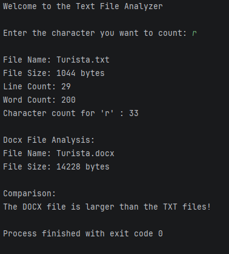

# TextFileAnalyzer

## Description

A Java console application that analyzes text files (.txt and .docx). It reports file size, line count, word count, and the frequency of a user-specified character within the text file. It also compares the file sizes of the two documents.

## How to Run

1. Place `Turista.txt` and `Turista.docx` in the same directory as your project.
2. Compile:
- javac TextFileAnalyzer.java
3. Run:   
- java TextFileAnalyzer
4. When prompted, enter the character you want to count (e.g., `e`).

## Files Analyzed

| File | Type |
|------|------|
| `Turista.txt` | Plain text |
| `Turista.docx` | Microsoft Word document |

## Sample Output

> **Note:** The program expects both files to be present in the working directory. If a file is missing, a `FileNotFoundException` message will be displayed.   